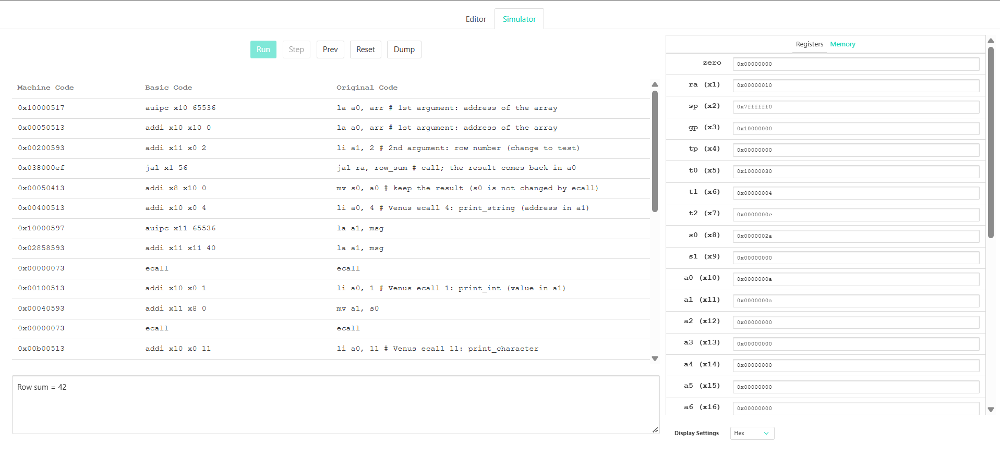
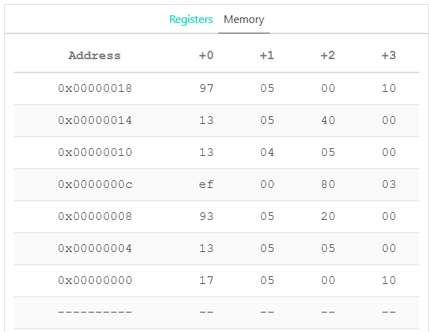

# Lab 1 — RISC-V assembly: sum of a row of a 2D array

**Author: Kostandy John Aymn Zakaria**, group: P4119 **Variant:** 5

## 1. Task

Variant 5: *find the sum of the elements of the row with a given number* in a
two-dimensional array of size N x M = 4 x 4.

The array is processed in a separate function. The algorithm is implemented
in RISC-V assembly (RV32I, run in the Venus simulator) and in C
(compiled with a RISC-V compiler, with a disassembly dump of the result).

## 2. Algorithm

The array is stored in memory **row by row** (row-major), 4 bytes per `int`:

```
address of arr[i][j] = base + (i * M + j) * 4
address of row r     = base + r * M * 4 = base + r * 16     (M = 4)
```

1. Compute the address of the first element of row `r`: `base + (r << 4)`.
2. `sum = 0`, `j = 0`.
3. While `j < M`: `sum += *p; p += 4; j++`.
4. Return `sum`.

Because M = 4 is a power of two, `r * 16` is a single shift (`slli`), so the
base RV32I instruction set (which has no `mul`) is enough.

## 3. Files

| File | Purpose |
|------|---------|
| `row_sum.s` | RISC-V assembly program for Venus (`row_sum` function + `main`) |
| `row_sum.c` | C implementation of the same algorithm |
| `row_sum.dump` | full `objdump -D` of the compiled C program (includes startup code) |
| `row_sum_funcs.dump` | only the disassembly of `row_sum` and `main` (the part used in section 7) |
| `images/` | screenshots from the Venus simulator |
| `README.md` | this report |

## 4. Assembly implementation and ABI

`int row_sum(const int *a, int row)`

| Register | Role in the program |
|----------|---------------------|
| `a0` | 1st argument: address of `arr`; **return value** (the sum) |
| `a1` | 2nd argument: row number |
| `t0` | pointer to the current element |
| `t1` | column counter `j` |
| `t2` | element loaded from memory |
| `t3` | constant `M = 4` |
| `ra` | return address (set by `jal`, used by `ret`) |
| `s0` | in `main`: keeps the result while `ecall` prints it |

Only the function that processes the array receives parameters, as required.
It is called with `jal ra, row_sum` and returns with `ret` (`jalr x0, 0(ra)`).
It uses only temporary (`t*`) and argument (`a*`) registers, which a callee is
allowed to change, so nothing has to be saved on the stack.

Venus system calls used: `ecall` with the id in `a0` and the argument in `a1`
(`1` print_int, `4` print_string, `11` print_character, `10` exit).
The result is moved to `s0` before printing, because `ecall` needs `a0` for the
call id.

## 5. C implementation and build

```bash
# the toolchain from the lab (riscv-gcc-10.2.0) is on PATH
riscv64-unknown-elf-gcc -march=rv32i -mabi=ilp32 row_sum.c -o row_sum.elf
riscv64-unknown-elf-objdump -D row_sum.elf > row_sum.dump
```

The full dump is long because the linked program also contains the startup
code and C library routines. The part written for this lab is found under the
`<row_sum>:` and `<main>:` labels; it is also saved separately:

```bash
riscv64-unknown-elf-gcc -march=rv32i -mabi=ilp32 -c row_sum.c -o row_sum.o
riscv64-unknown-elf-objdump -d row_sum.o > row_sum_funcs.dump
```

`N` and `M` are `#define` constants: with a constant `M` the compiler turns
`row * M` into a shift. With a variable column count it would need a
multiplication, which does not exist in `rv32i` (it would call a library
routine).

## 6. Run in Venus

1. Open https://www.kvakil.me/venus/ and paste `row_sum.s` into the editor.
2. Press *Simulator* → *Assemble & Simulate from Editor*, then *Run*.
3. Console output for row 2: `Row sum = 42`.



What the screenshot shows:

* The console prints `Row sum = 42` (9 + 10 + 11 + 12).
* `s0 = 0x2a` (42) holds the result returned from `row_sum`.
* `t1 = 4`: the loop executed 4 times; `t2 = 0xc` (12) is the last element read.
* `t0 = 0x10000030` points just after the row: row 2 starts at
  `0x10000020`, and 4 elements of 4 bytes were passed (16 bytes).
* `ra = 0x10` is the return address: the `jal` is at `0x0c`, so the next
  instruction is at `0x10`.
* `a0` and `a1` contain `0xa`: these are the values of the last `ecall`
  (exit and newline), not the result.
* `la a0, arr` is a pseudo-instruction expanded into two instructions
  (`auipc` + `addi`), because one instruction cannot hold a 32-bit address.

The array in the data segment (row-major, one word = 4 bytes):



Checked results for all rows of the array
`{1,2,3,4}, {5,6,7,8}, {9,10,11,12}, {13,14,15,16}`:

| Row | Expected sum | Result |
|-----|--------------|--------|
| 0 | 10 | 10 |
| 1 | 26 | 26 |
| 2 | 42 | 42 |
| 3 | 58 | 58 |

The C version gives the same values (`result == 42` for row 2).

## 7. Comparison: my assembly vs. compiler output

Compiled without optimization (`-O0`, the default), the C function becomes
**32 instructions** (`row_sum` in `row_sum.dump`, addresses `0x80000064`–`0x800000e0`),
the loop body is 17 instructions per iteration. My
hand-written function is **12 instructions**, the loop body is 6.

Why the compiler output is longer (see `row_sum_funcs.dump`):

* It builds a stack frame (`addi sp,sp,-48`, `sw ra,44(sp)`, `sw s0,40(sp)`, ...) and spills
  the arguments to the stack (`sw a0,-36(s0)`, `sw a1,-40(s0)`).
* `sum` and `j` live in **memory**, not in registers: every iteration
  loads and stores them (`lw`/`sw`).
* `a[row][j]` is recomputed every iteration: `row << 4`, `j << 2`, two `add`s.
* The loop condition `j < 4` is compiled as `3 >= j` (`li a5,3` + `bge`).

My version keeps everything in registers, advances a pointer by 4 each
iteration and computes the row address once before the loop.

With `-O2` the compiler unrolls the whole loop (the row has only 4 elements):
`slli`, `add`, four `lw`, three `add`, `ret` — 10 instructions, no loop.

Note: `objdump -D` also disassembles the `.data` section (the array) as if it
were code; those lines in the dump are just the array values.
